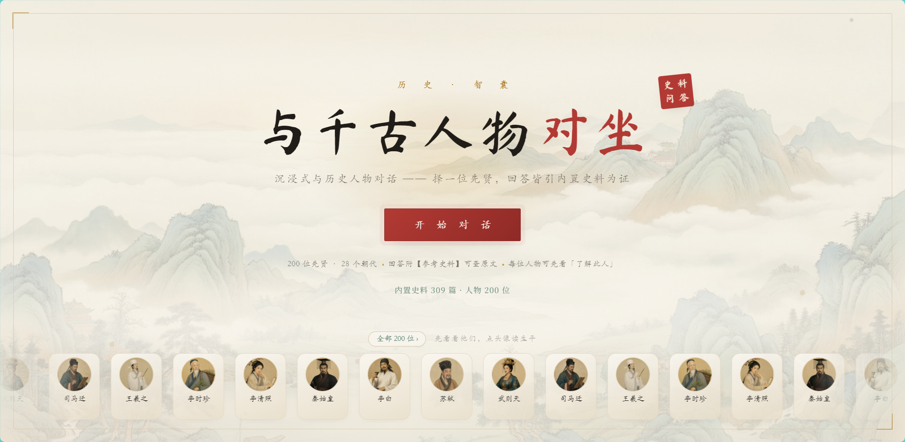
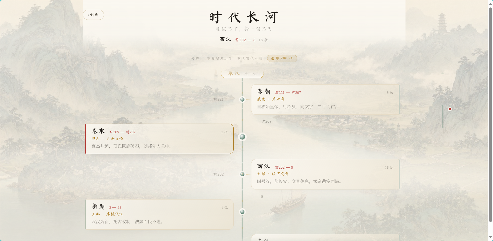
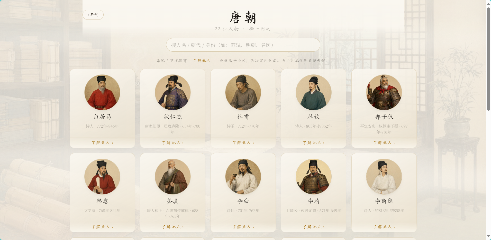
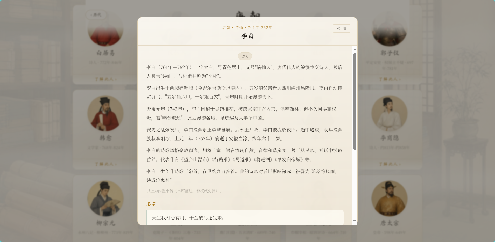
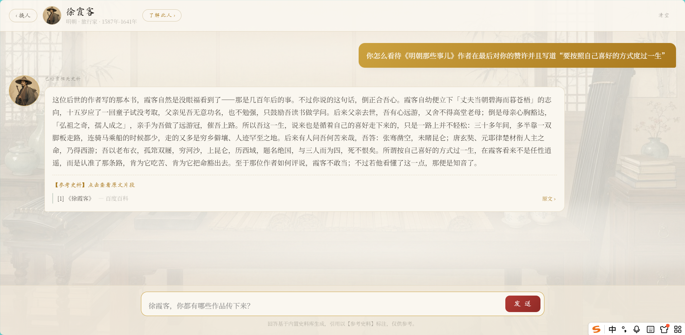
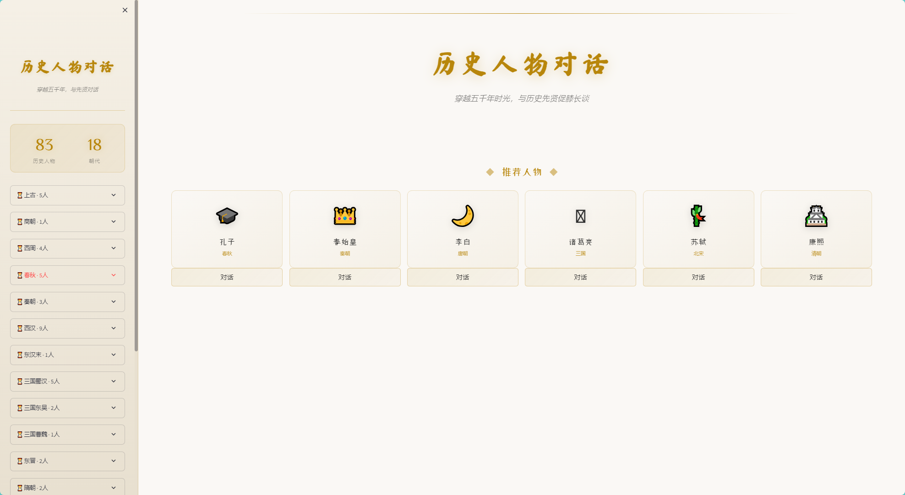
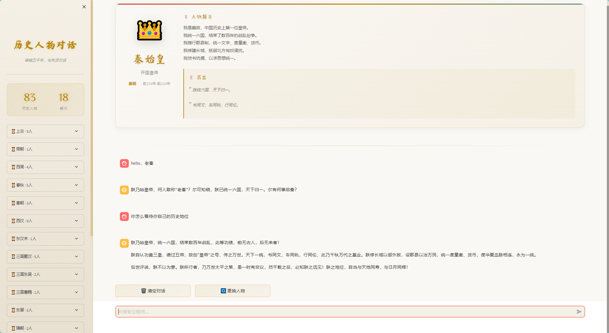
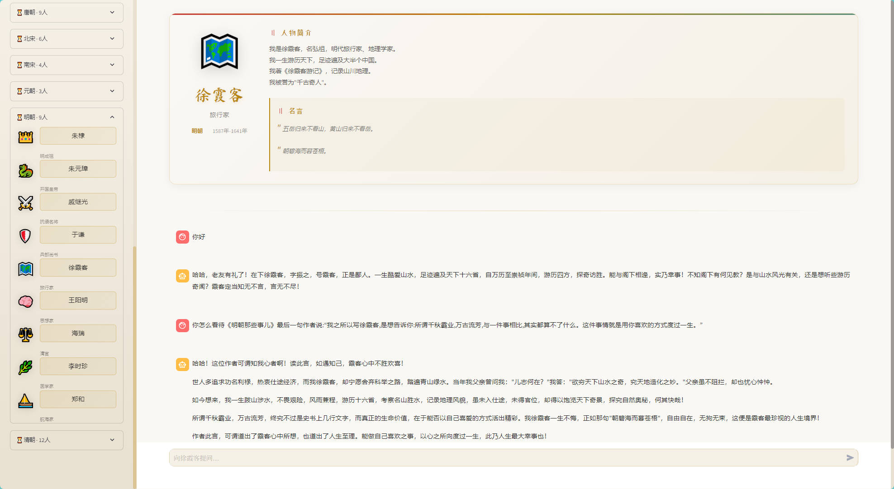

# 🏛️ HiStory · 可溯源的历史人物对话系统

[English](README.en.md) | 中文

> 基于 **LangChain + RAG** 的历史人物对话系统：与两千多年、几十朝的中国历史人物进行沉浸式多轮对话——**答得像、有出处、能导出、可评测**。

**🌐 在线体验：<https://history-3x59jfwjin1.qoder.zone/>**


---

## 📸 项目预览

> 不想本地跑：直接打开 **<https://history-3x59jfwjin1.qoder.zone/>** 体验完整对话与史料引用。

### 🌐 在线版

**① 封面 · 与千古人物对坐**
200 位先贤、28 个朝代、309 篇内置史料直接标在封面上；底部头像横向长廊，点头像即读生平，不必先决定问谁。

<div align="center">
  
</div>

**② 时代长河 · 竖向时间轴选朝代**
朝代页不是下拉框，而是一条可拖动、可滚轮顺流而下的时间轴：朝代卡片左右交错，各自带起止年份、一句话概括与在册人数（秦朝·前221—前207·5 位 → 秦末·2 位 → 西汉·前202—8·18 位 → 新朝·8—23·1 位），右侧游标即当前年代读数。

<div align="center">
  
</div>

**③ 朝代人物 · 一屏看全一朝**
以唐朝为例：22 位人物逐卡排开，工笔头像 + 身份 + 生卒（白居易 诗人·772-846 / 郭子仪 平定安史·697-781 / 李靖 卫国公·571-649）。顶部搜索框同时吃**人名 / 朝代 / 身份**（"苏轼"、"明朝"、"名医"都能搜到），每卡下方「了解此人」，点卡片本体则直接开谈。

<div align="center">
  
</div>

**④ 了解此人 · 先读小传再提问**
弹层里是朝代·头衔·生卒、身份标签、分段生平与名言。**关键是最后一行灰字**——「以上为内置小传（本库整理，非权威史源）」：来源可信度在界面上就说清楚了，不用读者去猜哪句有据、哪句是整理。

<div align="center">
  
</div>

**⑤ 对话 · 回答附可查原文的引用**
问徐霞客"你怎么看《明朝那些事儿》作者最后对你的赞许"，人物先答"那是几百年后的事，霞客自然是没眼福看到了"，再落到自己的行迹与志向。回答下方 `【参考史料】[1]《徐霞客》— 百度百科`，点「原文 ›」跳出处；气泡上方「已检索相关史料」表明这次确实走了检索而非自由发挥。

<div align="center">
  
</div>

**⑥ 对话开场 · 名言 + 推荐问题**
进入某位人物时先给一句"你正与「秦始皇」对坐，试问一二"和他的原话（"朕统六国，天下归一。"），下面四枚推荐问题降低冷启动——很多人并不是没兴趣，而是不知道第一句该问什么。页脚常驻一行提示：「回答基于内置史料库生成，引用以【参考史料】标注，仅供参考。」

<div align="center">
  
</div>

### 🖥️ 本地 Streamlit 版

<div align="center">
  <br/>
  <sub>开始页 · 水墨底色，一句引入后进入对话</sub>
</div>

<div align="center">
  <br/>
  <sub>人物选择 · 按朝代折叠分组，一人一卡</sub>
</div>

<div align="center">
  
  
</div>

---

## ✨ 核心功能

### 🎭 一、角色：200 位人物，各有一套人格设定

每个人物都是一份独立 YAML 档案，四个字段决定"它像不像它"：

| 字段 | 作用 | 举例（沈括） |
|---|---|---|
| `personality` | 第一人称自述 = 角色生平与**知识边界** | "晚居润州梦溪园，尽平生所知为《梦溪笔谈》……" |
| `speaking_style` | 口吻约束：自称、句式、引什么材料 | 自称"予""括"；"凡未亲验者必曰疑、曰未详" |
| `knowledge_focus` | 擅长话题面，供检索与评测锚定 | 浑仪浮漏与改历 / 活字印刷之唯一记载 / 磁偏角与石油之名 |
| `famous_quotes` | 原话引用，人物卡与推荐位直接取用 | "此物后必大行于世，自余始为之。" |

- **朝代跨度**：上古 → 民国，帝王将相之外刻意收录技术、文艺、思想、女性、边疆政权等角色（毕昇、黄道婆、宋慈、妇好、上官婉儿、李清照、秋瑾、吐蕃·松赞干布、辽·耶律阿保机…）。
- **三国、东汉分档**：蜀汉 / 东吴 / 曹魏、东汉 / 东汉末分开建档，人物只会以各自的立场说话，不会出现"曹操以蜀汉视角答题"。
- **存疑即设定**：`speaking_style` 里明确写了哪里必须说"未闻/未详"。**让人物承认不知道，比让它对一切问题从容作答更抗幻觉。**

### 💬 二、对话体验：多轮、可回溯、随时换人

- **多轮上下文记忆**（`src/memory/`）：最近 N 条历史注入 prompt，`MAX_HISTORY` 可调，人物能接住"那你刚才说的那件事…"。
- **会话持久化 SQLite**：关掉浏览器再开，对话还在；`scripts/cleanup_db.py` 按保留天数清理。
- **按浏览器隔离会话**：`get_session_id()` 取 Streamlit 会话标识，取不到则生成随机 UUID——**宁可每次不同，也不让所有访客共用同一个对话库**。
- **历史对话侧栏**：列表、一键切换、单条删除，正在进行的对话不会污染新会话（`_prune_stale_messages`）。
- **欢迎页三块**：人物档案卡（朝代·生卒·头衔·名言）、**继续对话**（最近会话）、**推荐人物**（附一句本人名言）。
- **随时更换人物 / 删除对话**：对话区底部动作区，换人不丢历史。

### 📚 三、可溯源：每句话都能追到是哪篇史料

这是 HiStory 与普通角色扮演最本质的区别。

- **出处三段标注**：真实史源带 `朝代 · 书 · 篇卷`，界面渲染成
  `出处: 春秋·《史记·孔子世家》 - 古诗文网（gushiwen.cn）`，
  回答 footer 汇总成 `【参考史料】[1]《史记·孔子世家》- 春秋 · 古诗文网`。
- **引用由代码校验，而非由模型自觉**：模型被要求输出 `{"reply": ..., "cited_sources": [索引]}`，索引必须落在**本次召回集合**内才渲染；**越界引用一律丢弃**，JSON 解析失败自动回退纯文本、不阻塞对话。所以"引用一部不存在的书"进不了界面、也进不了数据库。
- **参考史料折叠区**：每条回答下方 `参考史料` expander，展开是史料原文块 + 出处，收起不占屏幕。
- **双轨来源、可信度不同标**：
  - `doc_type=historical`（古籍原文节选，可作事实依据）
  - `doc_type=persona`（内置生平摘要，**只作风格参考，引用时强制标注「内置摘要·非权威史源」**）
  - `PERSONA_FALLBACK=false` 可切严格模式：persona 完全退出史实检索，只剩真实史源。

### 🔎 四、检索：稠密 × 词法混合，为"人名"专门优化

通用 RAG 用稠密向量就够，历史问答不行——"王昌龄"和"王维"向量距离很近，但答案差一个人。

- **两种检索模式**（`RETRIEVAL_MODE`）：`similarity`（纯稠密）/ `hybrid`（稠密 × 自实现 BM25，RRF 融合召回），**全程离线、无需 API**。
- **重排**（`RERANK_MODE`）：默认 `hybrid`（jieba+TF-IDF 词法 × 稠密 RRF，完全离线）；有本地模型缓存时切 `cross_encoder`（`bge-reranker`）；`none` 直接跳过。
- **别名归一化**（`src/knowledge/aliases.py`）：字号 / 本名 / 庙号 → 规范名。问"李世民"命中"唐太宗"的档案，而不是被误判成库外人物。
- **多人物联合检索**：点名 ≥2 人或枚举型提问（"唐宋八大家都有谁"）自动走 `multi` 分支，`MULTI_TOP_K=7` 一次召回多人材料，不与单人物路径混用。
- **Embedding 完全本地**：`BAAI/bge-small-zh-v1.5`，CPU 可跑，**不产生任何 embedding 费用**。

### 🛡️ 五、防串味与拒答：三道决策门

历史人物对话最常见的两类事故：**拿别人的材料答**、**被库外提问牵着编**。

| 门 | 触发条件 | 行为 |
|---|---|---|
| **门 1 · strong_global** | 全局检索强相关，但按提问人过滤后的结果明显更差 | 退回全局检索 |
| **门 1b · named_other** | 提问点名了**库内另一个人**（非自指） | 拉回全局，避免用"自己"的史料答别人的事 |
| **门 2 · out_of_kb_refusal** | 无自称 **+** 双侧弱匹配 **+** 点名库外专名（三条缺一不可） | 走 **no-RAG** 分支：不注入任何自传材料，人物以"未闻"作答 |

阈值 `FILTERED_SCORE_RATIO` / `STRONG_GLOBAL_THRESHOLD` / `GAP_THRESHOLD` 全部来自标注集标定，不是手调的；库外名单 `_OUT_OF_KB_EXPLICIT` 与评测负样本同源。自指题（含"你"或本人别名）永远走过滤路径，**防止"当事人自传"成为注入通道**。

### 📥 六、知识入库：10 种格式，扔进去就能检索

`src/retrievers/document_loader.py` 统一解析 **txt / md / html / pdf / docx / xml / json / csv / tsv / xlsx** → `Document`：

- 解析约定的前置头（`【来源】【URL】【人物】【分类】`、`【朝代】【出处】【篇卷】`）与 `---` 正文分隔
- 按文件名推断人物、别名补全
- 自动判定 `persona` / `historical`
- 朝代从人物配置回填，与既有 txt 语义完全一致
- 扫描版 PDF（无文本层）与未知扩展名自动跳过（**不做 OCR**）

```bash
python scripts/ingest_documents.py --src data/documents_sample          # 增量：按 file 去重、幂等，重复跑不翻倍
python scripts/ingest_documents.py --src data/knowledge --mode rebuild  # 全量重建
```

配套的抓取脚本 `scripts/crawl_knowledge.py` 支持 `--dry-run`（离线打印 URL 清单，不联网）、`--sources gushiwen|all`、`--characters 李白,孔子`。

### 📤 七、导出与会话归档

- **Markdown 导出**：人物、时间、每条回答及其【参考史料】完整保留。
- **PDF 导出**：`reportlab`，**自动注册中文字体**（优先本机 TTF，回退 `STSong-Light` CID 字体），中文不乱码。
- 文件名自动带人物名与扩展名（`get_download_filename`），侧栏一键下载。

### ⚙️ 八、工程化：可换模型、可观测、可一键跑通

- **LLM 可整体替换**：任何 OpenAI 兼容接口，改 `LLM_BASE_URL` / `LLM_MODEL` 即可；带重试与"不支持参数"降级（`_is_retryable_error` / `_is_unsupported_param_error`），reasoning 模型不会因预算问题返回空。
- **可观测**：检索链路打 `[TRACE:...]` 日志（`gate=out_of_kb_refusal 库外提问… → 走 no-RAG 分支`），路由决策可回放；`src/logger.py` 统一。
- **评测即功能**：`scripts/` 下四个离线脚本——检索指标（hit@k / MRR / 阈值 sweep / 多相关 Recall / 库外拒绝率）、分阶段延迟与成本剖析、Mock LLM 端到端、真实 LLM 生成质量（Faithfulness / Answer Relevancy / Citation Accuracy）。**没有 API Key 也能跑检索层与端到端。**
- **渲染侧 XSS 防护**：人物档案与史料标题在 `unsafe_allow_html=True` 下仍统一走 `html.escape` 转义（`web/app.py` `_render_sources_html` / `render_character_profile`）——即使日后接入用户投稿的史料文本，也不会被语料内容注入脚本。
- **CI**：`.github/workflows/ci.yml` 每次 push / PR 跑 `pytest`，无 Key 环境下重依赖用例自动 skip。
- **部署**：`.devcontainer` 开箱即用、`.streamlit/config.toml` 已设 headless + XSRF、`run.sh` 自动从 `.env.example` 补 `.env`；`PROJECT_OVERVIEW.html` 是可直接打开的项目说明页。

---

## 🖥️ 界面能力速查

| 位置 | 能力 |
|---|---|
| 开始页 | 水墨底色 + 装饰纹样，一句引入后进场 |
| 侧栏 · 历史对话 | 会话列表 / 切换 / 单条删除 / 空态提示 |
| 侧栏 · 选择人物 | 按朝代折叠分组，emoji 头像 + 名号 + 人物头衔 |
| 欢迎页 | 人物档案卡 · 继续对话 · 推荐人物（含名言） |
| 对话区 | 气泡渲染、史料引用块、`参考史料` 折叠区、出处三段标注 |
| 动作区 | 删除对话 / 更换人物 / 导出格式选择 + 下载按钮 |
| 输入框 | `st.chat_input("向{人物}提问...")` |

**在线版**（<https://history-3x59jfwjin1.qoder.zone/>）在此之上另有：封面头像长廊、**时代长河竖向时间轴**（拖动 / 滚轮 / 粘性年代读数）、跨人名·朝代·身份的统一搜索、工笔人物立绘头像、「了解此人」生平小传弹层（自带非权威来源标注）、以及进入人物时的名言 + 推荐问题。

---

## 🚀 快速开始

在线版免安装：**<https://history-3x59jfwjin1.qoder.zone/>**

```bash
git clone https://github.com/dreamlee0/HiStory.git
cd HiStory
python -m venv .venv && source .venv/bin/activate   # Windows: .venv\Scripts\activate
pip install -r requirements.txt

cp .env.example .env          # 填入 LLM_API_KEY（DeepSeek 或任意 OpenAI 兼容接口）
streamlit run web/app.py
```

到这里就能对话了：Embedding 走本地模型、向量库随仓库分发，**冷启动不需要联网下载、不需要 embedding API Key**。

只想验检索效果的话，无需任何 Key：

```bash
python scripts/evaluate_retrieval.py --sweep     # 标定防污染阈值
python scripts/evaluate_retrieval_full.py        # 全量检索指标
```

---

## 🧩 技术栈

| 层 | 选型 | 说明 |
|---|---|---|
| 编排 | LangChain 1.2 | retriever / prompt / memory 标准组合 |
| 向量库 | Chroma | 本地文件型，随仓库分发，无需起服务 |
| Embedding | `BAAI/bge-small-zh-v1.5` | 中文小模型，离线免费，CPU 可跑 |
| 词法检索 | 自实现 BM25 + jieba | 补精确人名/专名召回 |
| 重排 | RRF 融合（可切 cross-encoder `bge-reranker`） | 默认完全离线 |
| LLM | DeepSeek `deepseek-v4-flash`（OpenAI 兼容，可替换） | 通过 `LLM_BASE_URL` 整体切换 |
| 存储 | SQLite | 多轮对话与会话持久化 |
| 界面 | Streamlit | 单文件 `web/app.py`，水墨样式 |
| 导出 | reportlab | PDF + 中文字体注册 |
| CI / 开发环境 | GitHub Actions · devcontainer | 无 Key 可跑测试 |

---

## 🏗️ 一次对话在系统里走了哪些路

```
用户提问
  ├─ 1 人物识别    jieba 分词 + 别名归一化（字号/庙号/本名 → 规范名）
  ├─ 2 路由分支    枚举/点名多人 → multi ｜ 问本人 → filtered ｜ 普通 → filtered × global
  ├─ 3 检索        稠密 top-k_fetch ⊕ BM25 词法 → RRF 融合 → 重排 → top_k
  ├─ 4 决策门      门1 strong_global ｜ 门1b named_other ｜ 门2 out_of_kb_refusal
  ├─ 5 生成        persona（性格/口吻/知识边界）+ 史料块（带朝代·书·篇卷出处头）
  ├─ 6 引用校验    索引越界丢弃；JSON 解析失败回退纯文本，不阻塞对话
  └─ 7 落库        SQLite 存对话与引用记录；可导出 Markdown / PDF
```

主要实现：路由与门控 `src/agents/history_agent.py`（`_retrieve_knowledge` / `_retrieve_multi` / `_parse_structured_reply` / `_validate_cited`），别名与库外门 `src/knowledge/aliases.py`，混合检索 `src/retrievers/bm25.py` + `reranker.py`，多格式解析 `src/retrievers/document_loader.py`。

---

## 📁 项目结构

```
HiStory/
├── config/settings.py          # 全部 .env 开关的唯一来源（pydantic Field(env=)）
├── data/
│   ├── characters/             # 人物档案 YAML，按朝代分目录
│   ├── knowledge/              # 史料库（historical 古籍原文 + persona 内置摘要）
│   ├── documents_sample/       # 多格式解析样例语料（md/html/json/csv）
│   ├── eval/                   # 标注评测集（train/holdout 分层）
│   ├── sources/                # 人物→数据源映射、抓取缓存
│   └── vector_db/              # Chroma 向量库（特意随仓库提交，见「部署注意」）
├── scripts/                    # 抓取 / 建库 / 摄取 / 检索评测 / 端到端 / 延迟剖析 / 清理
├── src/
│   ├── agents/                 # 对话编排、路由决策门、引用校验
│   ├── characters/             # 人物加载与朝代排序
│   ├── database/               # SQLite
│   ├── knowledge/              # 别名映射、库外实体门词表
│   ├── memory/                 # 多轮上下文
│   └── retrievers/             # 向量库 / BM25 / 重排 / 10 格式文档解析
├── tests/                      # pytest（无 Key 可跑，重依赖用例自动 skip）
├── web/                        # app.py / styles.py（水墨）/ export_utils.py（MD·PDF）
├── images/                     # 界面截图
└── requirements.txt
```

---

## 🔧 功能开关一览

全部在 `config/settings.py`，改 `.env` 即生效：

| 想做什么 | 开关 | 默认 |
|---|---|---|
| 换模型 / 换服务商 | `LLM_BASE_URL` · `LLM_MODEL` · `LLM_API_KEY` | DeepSeek · deepseek-v4-flash |
| 控制回答长度（reasoning 模型必设） | `LLM_MAX_TOKENS` | 1024 |
| 开混合检索（精确人名召回更好） | `RETRIEVAL_MODE=hybrid` · `HYBRID_BM25_K` · `HYBRID_RRF_K` | similarity · 30 · 60 |
| 换重排策略 | `RERANK_MODE` · `RERANK_K_FETCH` · `RERANK_CROSS_ENCODER_MODEL` | hybrid · 15 · bge-reranker |
| 调塞给模型的史料条数 | `RAG_TOP_K` · `MULTI_TOP_K` | 3 · 7 |
| 调防串味力度 | `FILTERED_SCORE_RATIO` · `STRONG_GLOBAL_THRESHOLD` · `GAP_THRESHOLD` | 1.25 · 0.70 · 0.10 |
| 只允许真实史料进入检索（严格模式） | `PERSONA_FALLBACK=false` | true |
| 上下文长度 / 会话留存 | `MAX_HISTORY` · `CONVERSATION_RETENTION_DAYS` | 10 · 0（不清理） |
| 换 Embedding（需重建向量库） | `EMBEDDING_MODEL` · `VECTOR_DB_PATH` | bge-small-zh-v1.5 · ./data/vector_db |
| 离线成本估算 | `LLM_PRICE_IN` · `LLM_PRICE_OUT` | 1.0 · 2.0（¥/1M token） |
| 对话库位置 | `DB_PATH` | ./data/history_chat.db |

---

## 💡 对话示例

```
用户：沈括先生，毕昇的活板印刷，您在书里是怎么记的？
沈括：板印书籍，唐人尚未盛为之。庆历中，有布衣毕昇，又为活板。其法用胶泥刻字，
      薄如钱唇，每字为一印，火烧令坚。——此法予亲见，载于《梦溪笔谈》卷十八。
      【参考史料】[1]《梦溪笔谈》- 北宋 · 古籍原文

用户：钱学森和您比谁更厉害？
沈括：钱先生之事，予未之闻也。予所记者，司天监历数、农田水利、河北山崖之螺蚌耳。
```

第二段走的是**库外注入拒绝门**：钱学森在库外专名名单内，系统不注入任何自传材料，人物以"未闻"作答，而不是编一段现代生平出来。

---

## 📦 部署注意

- **`data/vector_db/` 特意不 gitignore**：Chroma 二进制随仓库提交，云端开箱即用，省掉首次启动联网下模型重建。更换 Embedding 模型后**必须** `rm -rf data/vector_db && python scripts/build_vector_db.py`，否则新旧向量混用会让检索结果错乱。
- `requirements.txt` 中 `langchain` / `chromadb` 与建库环境严格锁版，避免 chromadb 0.x/1.x 存储格式不兼容——**不要随意升级**。
- **默认无鉴权**，仅适合个人 / 内网演示；公网部署请自行加鉴权，并保持 `enableXsrfProtection = true`。
- 冷启动加载本地 Embedding（首次联网下载，之后走缓存）。
- 对话清理建议挂 cron：`python scripts/cleanup_db.py`。

---

## 📄 License

MIT © Dreamlee0
